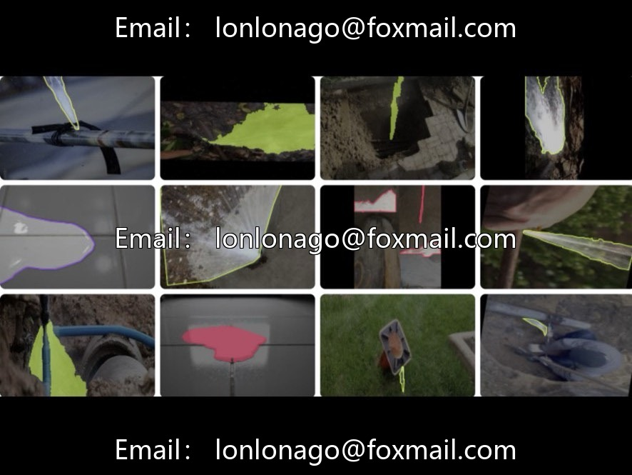

# Pipeline leakage example segmentation dataset

## Body

Pipeline leakage instance segmentation dataset for pipeline leakage identification | Issue 10783

The dataset consists of 9,376 real-shot images, focusing on the "pipe leakage point" category, covering various inspection scenarios such as outdoor and underground, suitable for intelligent inspection, leakage control, intelligent operation and maintenance in municipal water supply networks.

The annotation format supports YOLO/VOC/COCO (polygon masks), providing seven iteration versions of the datasets, covering scenarios such as pipeline rust, dark light, small water spots, and water splattering. The data volume is sufficient, suitable for leak detection baseline tasks.

Virtual materials, once sold, are non-refundable.
Interested friends, click "I want" to proceed.

## Images

## Payment

Here is a pay link on Stripe ( https://buy.stripe.com/3cs8yP7sY87d0vu9AB ). Please contact me lonlonago@foxmail.com after funding $89, and I will send you a complete data files , thank you!

